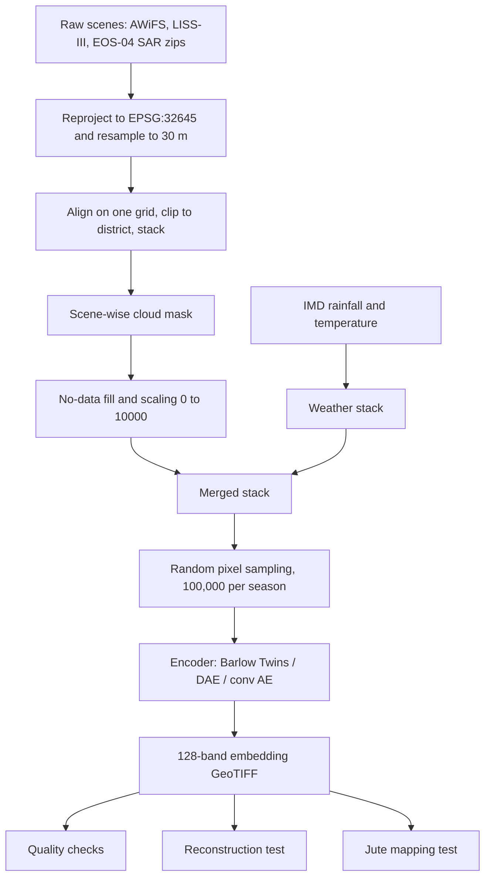

# Multi-Sensor Spatio-Temporal Embeddings for Indian Earth Observation

### A Self-Supervised Approach using AWiFS, LISS-III, and EOS-04 SAR


-yellow)

Learned, label-free **128-dimensional representations of every 30 m pixel**, built from Indian optical and radar satellites (**AWiFS**, **LISS-III**, **EOS-04 SAR**) and daily **IMD** rainfall and temperature. Pilot area: **Murshidabad district, West Bengal**.

Internship project at the **National Remote Sensing Centre (NRSC), ISRO**, Hyderabad.
Author: Manasvi Gangrade | Guide: Shri Pruthiviraj Behera, Scientist-SD

---

## Table of contents

1. [Overview](#1-overview)
2. [Highlights](#2-highlights)
3. [Input data](#3-input-data)
4. [Pipeline](#4-pipeline)
5. [Pre-processing in detail](#5-pre-processing-in-detail)
6. [Model](#6-model)
7. [Outputs](#7-outputs)
8. [Evaluation and results](#8-evaluation-and-results)
9. [Repository layout](#9-repository-layout)
10. [Quick start](#10-quick-start)
11. [Using the embeddings](#11-using-the-embeddings)
12. [Limitations](#12-limitations)
13. [Future work](#13-future-work)
14. [FAQ](#14-faq)
15. [Data availability](#15-data-availability)
16. [References](#16-references)

---

## 1. Overview

Satellites observe the same place repeatedly, with different sensors and in different seasons. A crop, a water body or a settlement leaves a characteristic **temporal signature**: its reflectance in the green, red, near-infrared (NIR) and short-wave infrared (SWIR) bands, the evolution of its vegetation index (NDVI), and its radar backscatter, which responds to structure and moisture and is unaffected by cloud.

Instead of hand-crafting a few features per task, this project learns a **general-purpose pixel embedding**, a compact vector that summarises the whole multi-sensor time series of a pixel, **without any labels**. Pixels with similar land cover and seasonal behaviour get similar vectors, so the embedding can be reused for classification, similarity search or change detection with very few labelled examples.

The idea follows **TESSERA** (global pixel embeddings from Sentinel-1 and Sentinel-2). This work builds the equivalent for **Indian satellites**, whose sensors, resolutions and revisit patterns are different, and adds **meteorological context** so that the same signal before and after rain can be told apart.

**Why these inputs**

| Input | Role |
|---|---|
| AWiFS | wide swath, 5-day revisit, frequent optical cover |
| LISS-III | finer optical detail (23.5 m) |
| EOS-04 SAR (HH, HV) | sees through cloud; essential in the monsoon |
| IMD rainfall and temperature | context of recent weather for each observation |

---

## 2. Highlights

- **End-to-end, script-based pipeline** from raw scenes to embedding GeoTIFFs; one command runs a whole season.
- **Three self-supervised encoders** compared on the same data: Barlow Twins (main model), denoising autoencoder (DAE) and convolutional autoencoder (conv AE).
- **Three seasons of 2025** processed independently: Apr-Jun, Jul-Aug, Nov-Dec.
- **Set-based transformer encoder** that accepts a variable number of valid (cloud-free) observations per pixel.
- **Weather dropout** during training so weather cannot act as a location code.
- **Two-sided evaluation:** how much information the embedding keeps (reconstruction test) and how useful it is (jute mapping test).
- **Key finding:** no single model is best everywhere. Barlow Twins separates jute best in the clear Apr-Jun season, while the autoencoders are better in the cloudy Jul-Aug season.

---

## 3. Input data

| Source | Details |
|---|---|
| AWiFS (Resourcesat-2/2A) | 4 bands (green, red, NIR, SWIR), 56 m, 740 km swath, 5-day revisit |
| LISS-III (Resourcesat-2/2A) | 4 bands (green, red, NIR, SWIR), 23.5 m, 140 km swath, 24-day revisit |
| EOS-04 SAR (RISAT-1A) | C-band, HH and HV, about 18 m |
| IMD rainfall | 0.25 degree daily grid (about 27 km) |
| IMD temperature | 0.5 degree daily grid, Tmax and Tmin (about 55 km) |
| District boundary | Murshidabad polygon |
| Jute reference (evaluation only) | 2025 jute map at 10 m, reduced to the 30 m grid |

Scenes are downloaded from the NRSC **Bhoonidhi** portal with `bhoonidhi_download.py`.

| Season | Period | Scenes | Optical (AWiFS + LISS-III) | SAR | Weather days |
|---|---|---|---|---|---|
| Apr-Jun 2025 | 14 Apr to 30 Jun | 64 | 54 (34 + 20) | 10 | 91 |
| Jul-Aug 2025 | 2 Jul to 31 Aug | 57 | 44 (24 + 20) | 13 | 62 |
| Nov-Dec 2025 | 2 Nov to 31 Dec | 96 | 88 (68 + 20) | 8 | 61 |

For Jul-Aug, 94 scenes were found on Bhoonidhi and 57 could be downloaded.

---

## 4. Pipeline



Every step is a separate script that writes files with self-explanatory names, so a new sensor, season or district can be added without changing the other steps.

---

## 5. Pre-processing in detail

| Step | What happens |
|---|---|
| **Reprojection** | All data are brought to **EPSG:32645 (UTM 45N)**, a metric system in which Murshidabad lies, so a pixel has a constant size in metres. Weather files, which come in latitude and longitude, are reprojected too |
| **Resampling** | AWiFS (56 m), LISS-III (23.5 m) and SAR (about 18 m) are resampled to one **30 m** grid. Identifier layers such as the weather cell map use nearest-neighbour resampling so cell numbers are never averaged |
| **Alignment and stacking** | All scenes share one grid origin, extent and cell size and are stored as bands of one multi-band GeoTIFF (int16, no-data -32768). Each band is described as `sensor\|date\|band\|scene`; a scene table records the first and last band of every scene, so band order equals time order |
| **Clipping** | The stack is clipped to the district extent; pixels outside the polygon are no-data. Grid size is 3161 x 4196 pixels, about 6.07 million of them inside the district |
| **Cloud mask** | One mask band per scene (0 no data, 1 clear, 2 cloud). A pixel is cloud if its visible reflectance is far above its own seasonal median and also bright in absolute terms, or if it is saturated or extremely bright; cloud is then grown by one pixel. SAR is not affected by cloud |
| **No-data fill and scaling** | Missing pixels inside the district are filled with the season mean of the same sensor band but stay flagged as invalid, so the model never mistakes them for observations. Optical: reflectance x 10000, clipped to 0 to 10000. SAR: `stored = (dB + 30) / 45 x 10000`, so -30 dB maps to 0 and +15 dB to 10000 |
| **Weather** | IMD grids are reprojected and assigned to pixels by nearest cell (16 rainfall and 6 temperature cells cover the district) and merged with the satellite stack |

### Observation (token) of one pixel

Each valid scene gives one observation:

| Sensor | Features |
|---|---|
| AWiFS, LISS-III | green, red, NIR, SWIR reflectance and NDVI |
| EOS-04 SAR | HH (dB), HV (dB), pass direction (ascending or descending) |
| Weather (all tokens) | rainfall of the last 7 and 14 days, mean Tmax and mean Tmin of the last 7 days |

---

## 6. Model

A **transformer encoder** (width 64, 2 layers, 4 attention heads) reads all valid observations of a pixel together, using one input layer per sensor and the day of the year, and outputs the **128-dimensional embedding**. A set-based design handles the varying number of valid observations per pixel.

A weather cell (27 to 55 km) is much larger than a pixel, so weather could become a location code. During training the weather of a random half of the pixels is therefore hidden.

| Model | Family | Training objective |
|---|---|---|
| **Barlow Twins** (main) | joint embedding | Two random subsets of the same pixel's observations must give the same embedding, while the 128 dimensions stay decorrelated |
| **Denoising autoencoder (DAE)** | reconstruction | Part of the observations is hidden and must be rebuilt from the rest |
| **Convolutional autoencoder (conv AE)** | reconstruction with context | A small network over 5 x 5 patches of the DAE embedding, so neighbouring pixels are also used |

Training setup: 100,000 random pixels per season, 20 epochs, about 4 hours per model on a CPU.

---

## 7. Outputs

| Item | Specification |
|---|---|
| Embedding map | one GeoTIFF per model and season, **128 bands**, float32, values **0 to 1**, no-data **-1**, EPSG:32645, 30 m |
| Folder per season | `outputs\2025_Apr_Jun`, `outputs\2025_Jul_Aug`, `outputs\2025_Nov_Dec` (selected with `EMB_OUT`) |
| Test results | reconstruction scores, jute scores, quality-check logs and figures in the same season folder |

The embeddings open directly in QGIS and can be used like any other raster.

---

## 8. Evaluation and results

### 8.1 Structural quality checks

Eight checks: format (128 bands, float32), no-data exactly outside the district, value range, dead bands, vector length, effective dimensionality, spatial coherence, and agreement with the distance between the original spectra. **All three seasons passed.** For the Apr-Jun Barlow embedding, 12 principal components explain 90 % of the variance, neighbouring pixels have cosine similarity 0.94 against 0.7 for random pairs, and the embedding keeps 87 % similarity when only a quarter of the scenes is used.

Probe (linear read-out of simple quantities, Apr-Jun Barlow): R2 0.94 for season-mean NDVI, 0.91 for SWIR, 0.93 for SAR HH mean, 0.85 for water share, 0.71 for season-maximum NDVI.

### 8.2 Reconstruction test: how much does the embedding keep?

A small decoder rebuilds the original observations (4 reflectances and NDVI per optical scene, HH and HV per SAR scene) from the embedding. It is trained on 21,000 pixels and scored on 7,000 unseen pixels. R2 = 1 is perfect, R2 = 0 equals guessing the scene mean. MAE, MSE, RMSE and NRMSE are also written, overall, per band and per scene.

| Embedding (pooled R2) | Apr-Jun | Jul-Aug | Nov-Dec | Mean |
|---|---|---|---|---|
| Barlow Twins | 0.686 | 0.536 | 0.746 | 0.656 |
| Denoising AE (generic decoder) | 0.799 | 0.727 | 0.779 | 0.768 |
| Denoising AE (own decoder) | 0.816 | 0.770 | 0.839 | 0.808 |
| Conv AE | 0.788 | 0.730 | 0.796 | 0.771 |
| Scene-mean guess (baseline) | 0.186 | 0.290 | 0.245 | 0.240 |

### 8.3 Jute mapping test: is the embedding useful?

**Reference:** 2025 jute map (91,307 ha, 16.7 % of the district). Clean labels use only cells that are at least 90 % or at most 10 % jute (5.2 million pixels, 12 % jute).

**Similarity method:** the district is cut into 3 km blocks (70 % learning, 30 % testing). The mean embedding of jute pixels and of other pixels in the learning blocks are two fingerprints, and each pixel is assigned to the closer one. No classifier is trained; test blocks are never used for learning.

| Season | Embedding | AUC (test blocks) | F1 (test blocks) | F1 (whole district) | Precision / recall (whole district) |
|---|---|---|---|---|---|
| Apr-Jun | Barlow Twins | 0.976 | 0.822 | 0.701 | 0.763 / 0.649 |
| Apr-Jun | Denoising AE | 0.949 | 0.750 | 0.640 | 0.702 / 0.589 |
| Apr-Jun | Conv AE | 0.955 | 0.769 | 0.662 | 0.706 / 0.622 |
| Jul-Aug | Barlow Twins | 0.835 | 0.471 | 0.479 | 0.395 / 0.610 |
| Jul-Aug | Denoising AE | 0.872 | 0.528 | 0.509 | 0.419 / 0.646 |
| Jul-Aug | Conv AE | 0.878 | 0.534 | 0.509 | 0.435 / 0.614 |
| Nov-Dec | Barlow Twins | 0.917 | 0.620 | 0.551 | 0.556 / 0.547 |
| Nov-Dec | Denoising AE | 0.892 | 0.608 | 0.537 | 0.562 / 0.515 |
| Nov-Dec | Conv AE | 0.901 | 0.630 | 0.543 | 0.577 / 0.513 |

Test-block values use the clean labels; whole-district values compare with the full reference map including mixed cells.

**Other ways of using the Apr-Jun Barlow embedding:** a classifier on 40,000 labelled pixels reaches jute F1 about 0.75 on unseen blocks; fine-tuning the encoder gives 0.77 (mean of three splits), and the same network without pre-training also gives 0.77. 21 hand-made features from the same data give 0.735. The advantage of the embedding over raw features is therefore small in this task.

### 8.4 Summary of findings

| Finding | Evidence |
|---|---|
| DAE keeps the most information | reconstruction R2 0.81 (own decoder) against 0.66 for Barlow Twins |
| Barlow Twins is best in the clear season | Apr-Jun jute F1 0.70 against 0.64 and 0.66 |
| Autoencoders are better in the monsoon | Jul-Aug jute F1 0.51 against 0.48; reconstruction gap largest in the same season |
| Nov-Dec is a tie | jute F1 0.54 to 0.55 |
| No model wins everywhere | best choice depends on how many clear observations a season offers |

---

## 9. Repository layout

| File or folder | Purpose |
|---|---|
| `bhoonidhi_download.py` | Search and download scenes from Bhoonidhi |
| `preprocess_stack_scenes.py` | Reprojection, resampling, alignment, clipping, stacking |
| `cloudmask_scenes.py` | Scene-wise cloud mask |
| `fill_rescale_stack.py` | No-data fill and scaling |
| `weather/weather_prep.py` | IMD weather preparation |
| `merge_stack_layers.py` | Merge satellite and weather stacks |
| `build_samples.py` | Random pixel samples for training |
| `pixel_encoder.py` | Transformer encoder |
| `barlow_twins.py` | Barlow Twins training |
| `denoising_autoencoder.py` | DAE training |
| `convolutional_autoencoder.py` | Conv AE training |
| `embed_to_tif.py` | Write embedding GeoTIFFs |
| `validate_embeddings.py` | Quality checks, robustness (`--robust`), probe (`--probe`) |
| `reconstruct_from_embedding.py` | Reconstruction test |
| `jute/` | `jute_inspect`, `jute_similarity`, `jute_classify`, `jute_finetune`, `jute_map_compare` |
| `season_pipeline.ps1` | Runs the whole pipeline for one season |
| `common.py` | Shared helpers; finds files in the season folder by name pattern |

---

## 10. Quick start

### Requirements

Python 3 with `numpy`, `rasterio`, `geopandas`, `torch`, `matplotlib`. QGIS is recommended for visual checks. A CPU is enough (about 4 hours per model); a GPU is optional.

### Configure folders (PowerShell)

```powershell
$env:EMB_DATA = "<folder containing the satellite zips>"
$env:EMB_OUT  = "outputs\2025_Apr_Jun"      # one output folder per season
```

All files of a season are written to its `EMB_OUT` folder. Pipeline files must stay in the root of that folder because `common.py` finds them by file-name pattern, and the season tag is taken from the raw `satellite_stack_*.tif` name, so the raw stack must not be deleted.

### Run one season

```powershell
.\season_pipeline.ps1
```

### Validate and test

```powershell
python validate_embeddings.py --kind barlow --probe
python validate_embeddings.py --kind barlow --robust
python reconstruct_from_embedding.py --kind barlow
```

`--kind` selects the embedding (`barlow`, `dae`, `conv`). Each script starts with a detailed header comment that lists all options.

Rules while running: do not open or rename output files while a script writes; keep QGIS closed; run only one heavy job at a time.

---

## 11. Using the embeddings

Open the 128-band GeoTIFF in QGIS or read it in Python:

```python
import rasterio

with rasterio.open("outputs/2025_Apr_Jun/<embedding_file>.tif") as src:
    emb = src.read()          # shape (128, rows, cols), float32, 0 to 1
    nodata = src.nodata       # -1 outside the district
```

Typical uses: cosine-similarity search from a few example pixels (as in the jute test), a small classifier on the 128 bands, clustering, or change detection between seasons.

---

## 12. Limitations

- One district, one year and one downstream application (jute) were tested; the accuracy of the reference jute map is unknown.
- Small training set (100,000 pixels, 2-layer model) compared with TESSERA; each model is tied to the scene list of one season.
- Weather cells (27 to 55 km) are much larger than pixels; weather dropout reduces but does not remove the risk of block artefacts, which still needs a dedicated test.
- The probe targets are built from the model's own inputs, so the probe is not an independent accuracy.
- Robustness and probe are complete only for the Apr-Jun Barlow embedding; classifier and fine-tune jute tests exist for Apr-Jun and Jul-Aug only.
- Sep-Oct and Jan-Mar are not covered, so the year is incomplete.

## 13. Future work

- One model for any number of observations and all seasons together; a full-year model.
- A second district and a multi-class land-cover reference.
- Comparison with TESSERA and other published embeddings.
- A rule for pixels with too few valid observations.
- A dedicated test for weather block artefacts.

---

## 14. FAQ

**Why 30 m?** It is close to the LISS-III scale, keeps most of the radar detail and does not over-interpolate AWiFS (56 m).

**Why separate models per season?** The seasons have different scene lists, so the observation sets differ.

**Why is a filled value kept invalid?** A filled value carries no information; flagging it prevents the model from learning from it.

**Why is Barlow Twins the main model if the DAE reconstructs better?** Barlow Twins gives the best jute separation in the clear season and is trained to be invariant to which scenes are available. The choice is not final; see the limitations.

---

## 15. Data availability

Satellite data, weather data and embeddings are large and are **not** part of this repository.

## 16. References

- Feng et al., *TESSERA: pixel-wise Earth observation embeddings from multi-sensor time series* (2025).
- Zbontar et al., *Barlow Twins: Self-Supervised Learning via Redundancy Reduction*, ICML 2021.
- Vincent et al., *Extracting and Composing Robust Features with Denoising Autoencoders*, ICML 2008.
- Vaswani et al., *Attention Is All You Need*, NeurIPS 2017.
- NRSC Bhoonidhi portal; Resourcesat-2/2A and EOS-04 product documentation; IMD gridded rainfall and temperature data.
